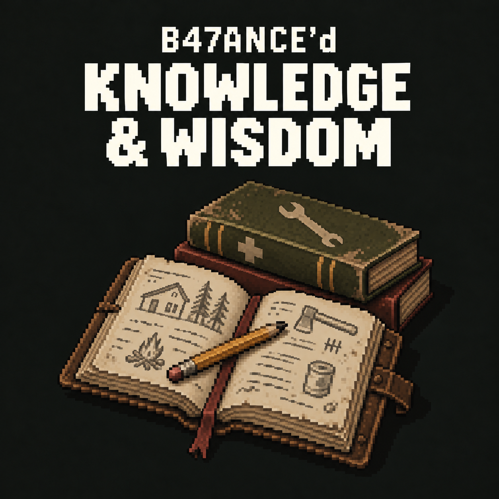

Authoritative source: `src/B47ANCEDKnowledgeAndWisdom/42`. `Contents/`, `dist/`, and
`SHA256SUMS.txt` describe historical builds and must not be deployed as the current version.
The old three-mod candidate tooling has not been migrated to this identity.

# B47ANCED Knowledge & Wisdom

The user-supplied project thumbnail is used unchanged for `preview.png` and the
source authoring thumbnail. See [artwork provenance](docs/ARTWORK.md).

B47ANCED Knowledge & Wisdom provides lore, research, survivor knowledge, and
experience-progression infrastructure for B47ANCE'd mods and other providers.

- Status: version `0.14.1` Project Archive, registered knowledge definitions,
  composable prerequisites, semantic-action progression, vanilla research viewer,
  host-verified Survivor Journal persistence/recovery core, and a progressive
  in-game test/result-export harness, and bounded unified knowledge claims;
  human validation pending.
- EXT-25 includes a bounded, non-mutating recorded-media projection using
  Build 42 media IDs, line GUIDs, and native per-character known-line state.
  Title visibility is caller-policy controlled; reward codes are never exposed.
- EXT-25/26 claims retain provenance, scope, acquisition, confidence,
  completeness, revocation, and replay history. Geographic familiarity accepts
  only explicitly registered regions and never reveals live world state.
- EXT-32 now provides provider-validated, world-persistent survivor-history
  records with stable author/subject/evidence identity, bounded sanitized text,
  visibility checks, full-request replay binding with caller re-authentication,
  and tombstone removal. It creates no
  memorial objects automatically.
- Mod ID: `B47ANCEDKnowledgeAndWisdom`
- Author: B47ANCE
- Hard dependencies: none beyond Project Zomboid.
- Consumers: Project M.O.R.T.I.S., Project Nightfall, medWorks, and any other
  mod registering discoverable knowledge.

The canonical Mod ID, source namespace, Lua entry points, sandbox page, and
public global are all **B47ANCEDKnowledgeAndWisdom** as of 0.13.0. Update consumer Mod ID
dependencies and imports together; the previous Lua global/import paths are not
aliases. Immutable saved-data keys, built-in claim IDs/owners and replay bindings
remain intact behind private compatibility code. The earlier pre-0.7.0 storage
migration remains supported. See [upgrade instructions](docs/IDENTITY_MIGRATION.md).

**The knowledge subsystem is internal, not another mod.** It owns knowledge,
literature, research and persistent study/Survivor Journal systems.
Domain mods own their content; vanilla remains authoritative for normal skill
XP and recipes. Semantic XP is implemented. Survivor Journals now provide the
physical persistence, progressive writing, claim, and recovery-plan core; native
timed actions and raw-XP application remain gated on in-game API verification.
Knowledge IDs are namespaced, provider-owned definitions rather than unchecked
document strings. Requirements support nested ALL, ANY, and NOT document or
knowledge rules; legacy prerequisite lists use the same evaluator.

Domain mods may register weighted semantic actions and report only committed,
meaningful outcomes. B47ANCEDKnowledgeAndWisdom applies normalized skill weights through
vanilla `addXp`, with bounded failure credit, restrained quality and difficulty,
source-aware diminishing returns, authority rejection, and uncertain-award quarantine.

See [approved requirements](docs/PROGRESSION_AND_JOURNALS.md),
[repository and migration audit](docs/REPOSITORY_AUDIT.md), and
[roadmap](docs/ROADMAP.md). Installed-game API verification precedes new framework
implementation; consumer imports/dependencies must use the renamed identity.

Run `python scripts/check_versions.py`, `python scripts/validate_source.py`, and
`python scripts/run_host_tests.py` (Python with Lupa Lua 5.1). These are offline
checks. See [current validation](docs/VALIDATION_0_14_1.md) and
[version/package policy](docs/VERSION_POLICY.md). G7 dedicated MP and stable G8
are BLOCKED. No deployment or publication was performed for this rename.

Public source: [B47ANCE/B47ANCEDKnowledgeAndWisdom](https://github.com/B47ANCE/B47ANCEDKnowledgeAndWisdom).
Repairs use branch `fix/authority-persistence-0.14.0`; main retains the audited
0.13.0 baseline until PR review/merge. See [repair contract](docs/REPAIRS_0_14_0.md),
[server settings](docs/CONFIGURATION.md) and [native test procedure](docs/RUNTIME_VALIDATION_0_14_0.md).
Other projects' integrations have not been changed. Native journal timed actions,
raw-XP restoration and dedicated synchronization remain runtime gates.
